# OverEngineered Solar

A Home Screen widget for the Scriptable app on iPhone, for use with Enphase® solar systems.

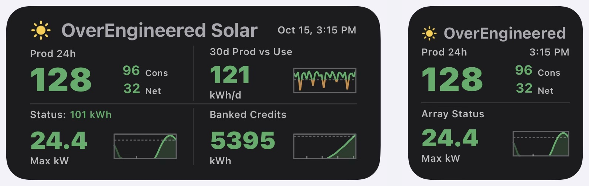

I knew it worked when I stopped opening the Enphase app every day to check on my solar. That's what a widget is supposed to be for.

## What this adds to the Enphase app

- **On your Home Screen.** No app to open and wait for. The numbers are just there.
- **On your Lock Screen too.** Today's production, peak and net, without unlocking your phone.
- **Hardware fault warning.** Checks once a day for a failed microinverter or meter, so you don't have to look through each panel.
- **A full day, always.** The last 24 hours, not since midnight, so the morning isn't blank.
- **Good day or bad day.** Every number is green or orange against your own last 30 days.
- **Yesterday and today on one curve.** Watch today's power build right next to yesterday's.
- **Banked kWh estimate.** A running estimate of your bank between bills, and which way it's heading.
- **Dirty panel warning.** Tells you when the panels might need washing.

For live power, per-panel detail and long-term history, tap the widget to open the Enphase app.

Guide version 2026.10.29.1150. Written for widget 2026.10.28.1117, setup 2026.10.28.0956 and dev sandbox 2026.10.29.1150.

**Everything here runs on your iPhone, inside the Scriptable app.** A computer is only useful for reading this guide and, if you like, creating the Enphase developer account.

**Setting it up?** Print the [printable guide](https://overengineered-tech.github.io/OverEngineered-Solar/Printable-Guide-OverEngineered-Solar.pdf) first, or open it on a second screen. Setup is easier with the steps and pictures beside you.

Not affiliated with or endorsed by Enphase Energy, Inc. Enphase is a registered trademark of Enphase Energy, Inc.

Licensed under the PolyForm Noncommercial License 1.0.0. Personal and other noncommercial use is free. Commercial use needs permission; open an issue to ask.

## What it shows

**Title row.** A weather icon for your location, your title, and the time of the newest data, which tells you how fresh the numbers are. The time turns orange if the last update failed, or in daylight if the newest reading is more than 2 hours old. When the array is running near its peak the icon is a bright sun, whatever the forecast says.

**Four boxes.** On the medium widget, Prod 24h is top left, 30d Prod vs Use is top right, Array Status is bottom left and Banked Credits is bottom right.

**Prod 24h.** Production over the last 24 hours as the big number, with consumption (Cons) and Net beside it, all in kWh. This is a rolling window ending now, not "since midnight", so on two similar days the numbers stay steady. Numbers under 10 show one decimal.
- Net is production minus consumption over the same 24 hours: green at zero or above, orange below.
- **Today view (optional).** Long-press the widget, choose **Edit Widget**, and type `today` in the Parameter box. That widget's numbers then count from midnight, under the heading "Prod Today". Prod is green when it is ahead of yesterday at the same time, and Cons is green when it is under yesterday at the same time; early each morning, before yesterday's totals are saved, they show green. Leave the box empty for the past 24 hours. Works on the medium and small sizes, so you can have one of each.
- Prod is green when it is at or above your 30-day average production, orange when below.
- Cons is green when it is at or below your 30-day average consumption, orange when above.
- With "Show Exported / Imported" switched on in setup, Cons is replaced by two smaller numbers: **Exp**, the energy you sent to the grid, and **Imp**, the energy you took from it. They are worked out by comparing production and consumption every 15 minutes, so they read a little lower than your utility's meter. They need consumption meters, and with a home battery they are not your grid numbers, because the battery sits in between.

**30d Prod vs Use.** Your average daily production over the last 30 days, in kWh a day, with each of those 30 days in the small box on the right. Green means you are producing at least as much as you use, on average. In the box, the dashed line is your average daily use: days above it are green, days below it orange. A small dot on the bottom edge marks the 1st of the month.

**Banked Credits.** Your running net-metering balance in kWh (shown under the number when the bank chart is on): the balance from your last bill, plus everything produced minus everything consumed since then.
- It follows your bills. Setup asks for your bill day of the month. On each bill day, a balance below zero goes back to zero; a balance above zero stays. On the bill day of your true-up month, any credits left over are forfeited, so the balance goes to zero. A short month uses its last day. If you don't give a bill day, the widget uses the day of the bill date you entered. This is the usual rule, but it has not yet been checked through a real true-up month, so check the number against your bill.
- With the bank chart switched off, today's Net also shows beside the balance.
- The small chart on the right (the "12-month bank chart" setting, on unless you switch it off) is your bank over the last 12 months, one point every two weeks. The top of the box is the highest balance in those 12 months, and it moves by itself as months roll by. The dotted line is today's balance, so it meets the right end of the line. Small dots along the bottom edge mark the start of each quarter (Jan, Apr, Jul and Oct 1). It shows whether your credits are still growing or being drawn down for the winter. From your bill date on it uses the same numbers as the balance; before that it is worked back from the bill, so it shows the shape rather than exact past balances, and it starts from zero after your true-up month. Months before your system's turn-on date are left blank, so on a young system the line starts part way across. It makes no extra Enphase requests.
- The balance keeps moving day and night. What the house uses overnight comes off it as the night goes on, not all at once after sunrise.
- If the estimate goes below zero the label reads "Credit Deficit".
- Your utility's meter is the one you're billed on, so the bill is the true number. Enphase's meters can differ from it by about 2% of a month's usage. If you go back into setup and update your bank balance from your bill periodically, it will track pretty closely.
- With a home battery, some energy is lost passing through it, so this number and Net read a little high.
- If your utility does not bank kWh one for one (net billing, such as California NEM 3), switch off "My utility banks kWh credits" in setup. The box is then labelled "Net Since" with your chosen date, and shows production minus consumption since that day.

**Array Status.** A health check and a chart. It sits at the bottom left of the medium widget.
- The heading line reads **Status:** and then today's production so far, for example "Status: 101 kWh". The figure is green when you are ahead of yesterday at the same time and orange when you are behind (green until yesterday's totals are saved). When something is off, a word goes in front of the figure and the figure takes the word's colour: **Dirty** (orange: the peak has dropped a little, and the panels may need washing), **Dirty** in red (the peak has dropped a lot), **Winter** (the sun is too low to judge, so the number holds its last real value until spring) or **Service Required** (red, with no figure: Enphase is reporting a hardware fault).
- The chart is the last 24 hours of production. The right end is your current power. The dashed line marks the highest reading in the last hour. The small dot on the bottom edge is midnight, so you can see where today started; yesterday's part of the curve, left of it, is drawn faded.
- The number, "Max kW", is your array's peak power across the last five clear days. It is compared with what your array should put out on a clear day, as a read on how clean the panels are. The number is always green; the heading line above it carries the colour.

Tap the widget to open the Enphase app. Scriptable shows for a moment on the way; that is how iOS handles a widget tap.

## What you need

- An iPhone with the free [Scriptable](https://scriptable.app) app.
- An Enphase system and the login you use in the Enphase app.
- A free Enphase developer account. Setup walks you through creating one.

Consumption monitoring is optional. Without it, setup asks for a daily usage estimate.

## Install

[Scriptable](https://scriptable.app) is a free iPhone app that runs small scripts and can show one as a Home Screen widget. This widget is two of those scripts: one you run once to set things up, and one that draws the widget.

**Recommended: print the [printable guide](https://overengineered-tech.github.io/OverEngineered-Solar/Printable-Guide-OverEngineered-Solar.pdf) before you start.** The link opens the guide as a PDF you can print or save. It has every step and picture on paper, so you can follow along while your phone is busy with the install.

Do all of this on your iPhone. The scripts have to be in Scriptable on the phone, and setup has to run there, because that is where it reads your keys and saves your settings.

1. Install **Scriptable** from the App Store.
2. In Safari on your iPhone, open this project's GitHub page and tap `setup-overengineered-solar.js` in the file list.
3. Tap the **⋯** at the right of the row that says **Code | Blame**, then tap **Copy** under “Raw file content”. The whole script is now copied.

   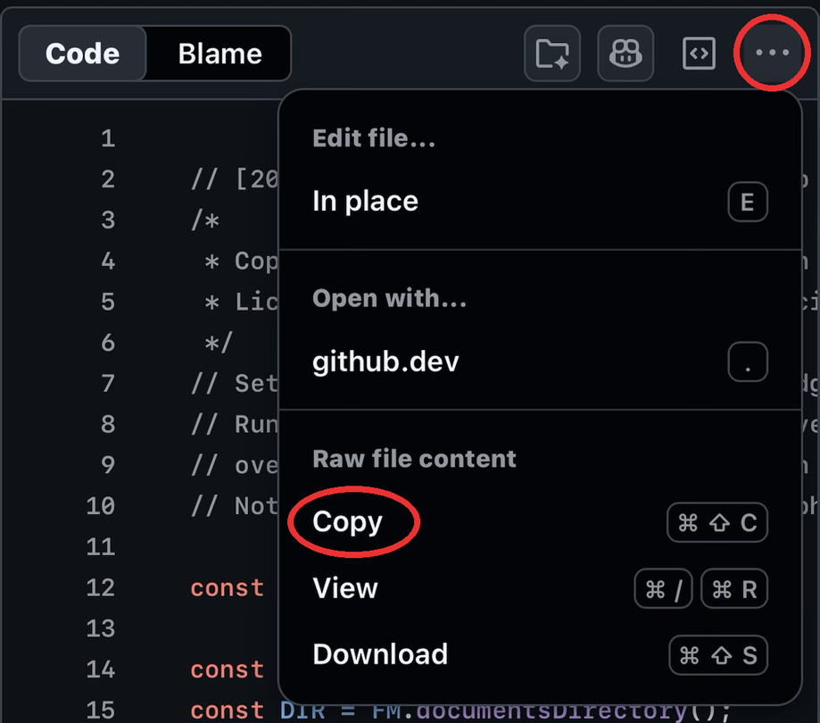

4. Open Scriptable and tap **+** at the top right. Paste, then tap **Done** at the top left.
5. Back in the script list, press and hold the new **Untitled Script**, tap **Rename**, and call it **OverEngineered Solar Setup**.
6. Go back to GitHub and do the same with `widget-overengineered-solar.js`: copy it, paste it into a new script, tap **Done**, then rename that one **OverEngineered Solar**.
7. In Scriptable, tap **OverEngineered Solar Setup** to run it (next section).
8. When setup is finished, add a Scriptable widget to your Home Screen, long-press it, choose **Edit Widget**, and pick **OverEngineered Solar** as the script.

The script names are suggestions. Any names work, as long as you can tell the two apart.

## Setup

In Scriptable, tap **OverEngineered Solar Setup** in the script list to run it. The first run has three parts.

**1. Get your keys.**

1. Tap **Open Enphase Developer Site**. If a cookie box appears, tap **Accept All Cookies**.
2. Tap **Sign Up**, the small link under the Sign In button.

   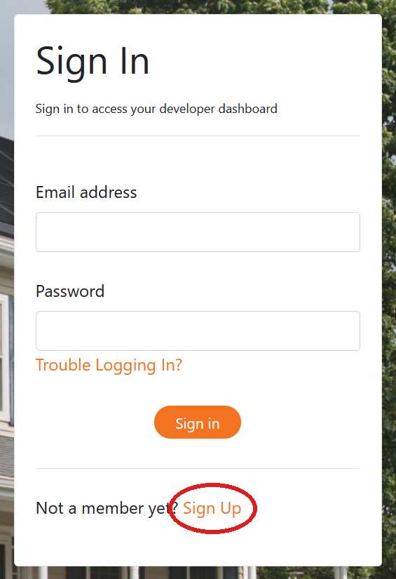

3. Fill in the form. **Organization/Group Name** and **Username** can be anything, such as “Home”.

   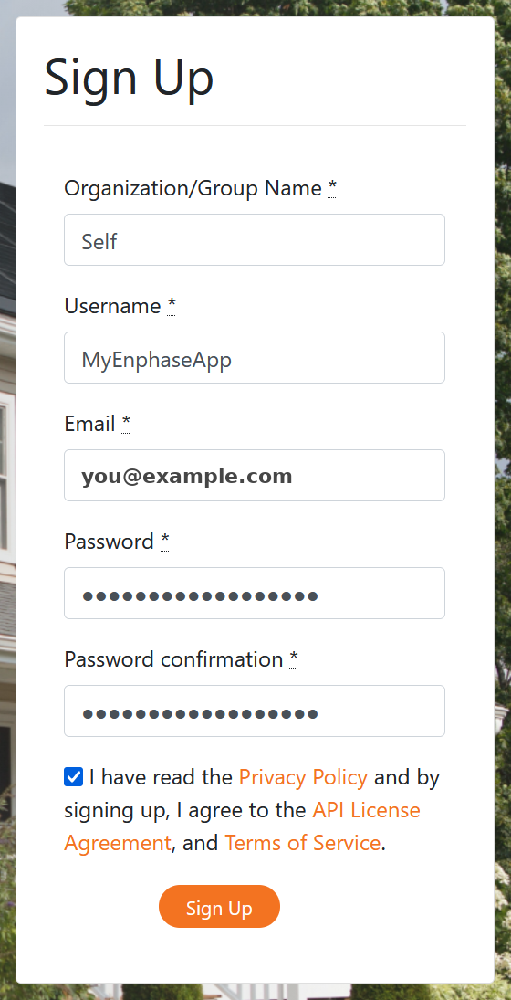

4. Enphase emails you an activation link. It comes from api@enphaseenergy.com with a subject starting “Action Required”; check spam if you don't see it. Tap the link. It opens in Safari and only confirms your account. (A second tap says “already activated”, which is fine.)
5. **Go back to Scriptable** and sign in there, on the page setup opened. Setup can only read your keys from that page, not from Safari. On the welcome page tap **Applications** in the menu at the top, not the big Quick Start button.

   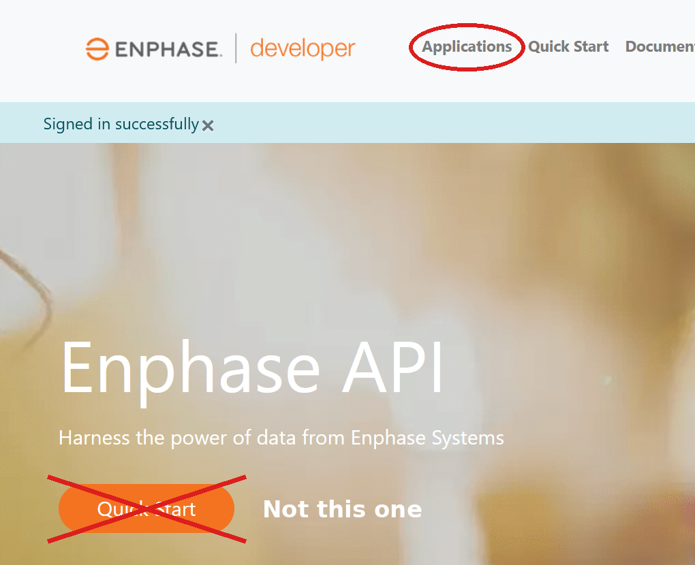

6. Tap **Create new application**.

   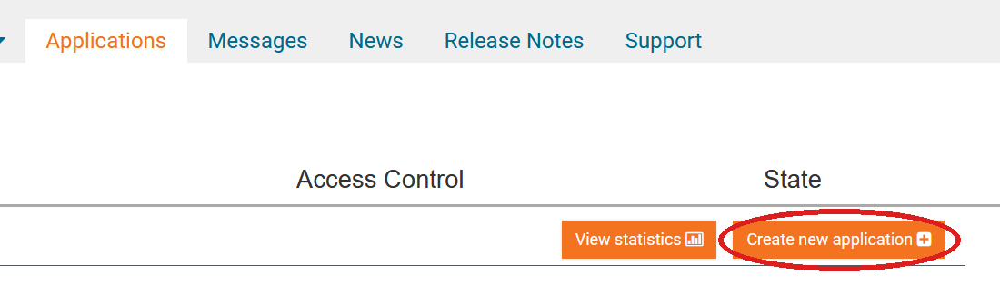

7. Leave the plan on **Watt** (free). Name, Description and Developed By can be anything.
8. **Access Control: check every box.** They all start unchecked, and the widget can't read your data without them.

   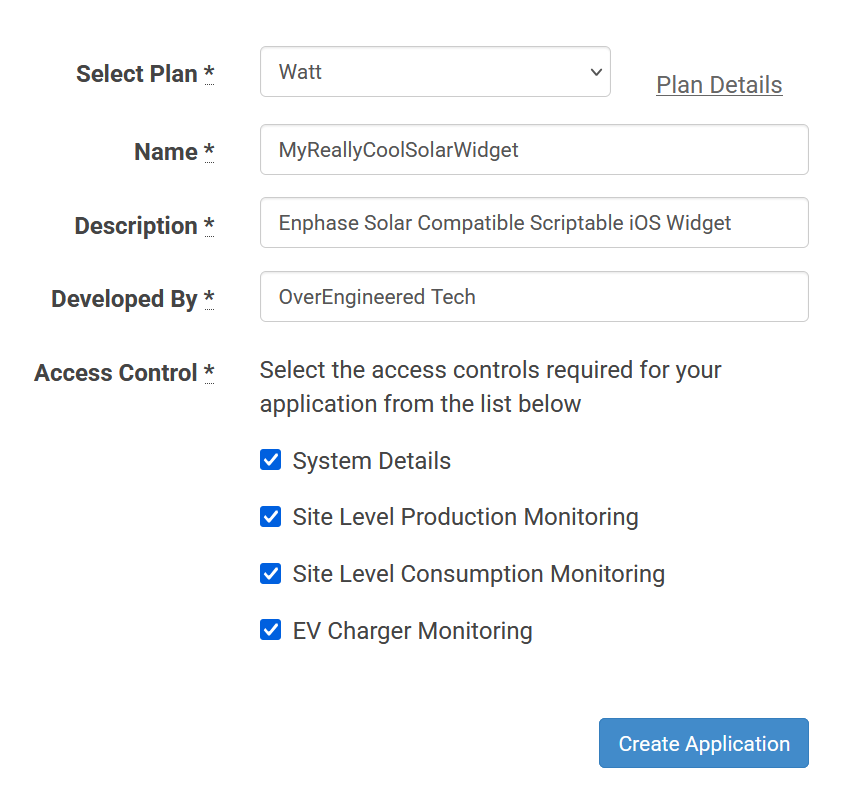

9. Tap **Create Application**. After a moment the page reloads and shows your **API Key**, **Client ID** and **Client Secret**. Wait until you can see all three.

   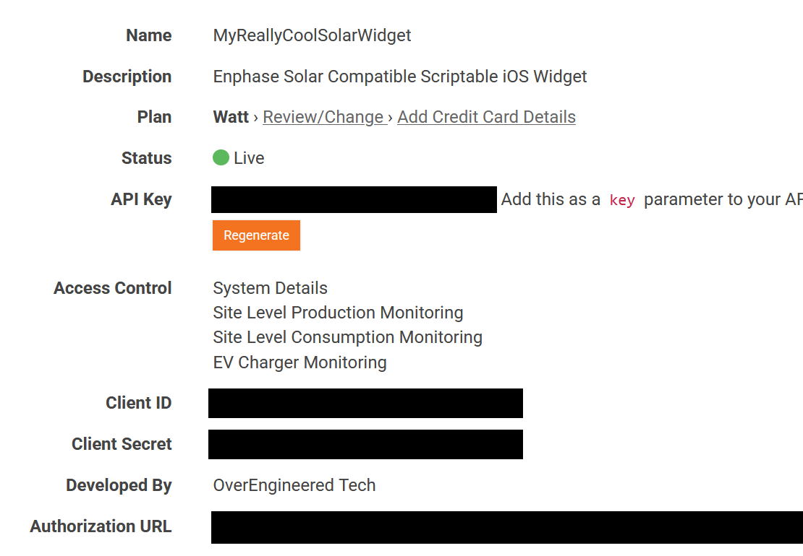

10. Tap **Close** at the top left. Setup reads the three keys for you. (You can also type them in.)

*Optional: the Enphase developer site is easier on a bigger screen. You can create the developer account and the application on a computer if you prefer. You still run setup on your iPhone afterwards and sign in there, and it reads the keys the same way.*

**2. Approve access.** Tap "Continue to Enphase login", log in with your normal Enphase account (not the developer one), tap Authorize, then tap **Close**. This lets the widget read your system. It cannot change anything.

**3. Fill in the form.** Your system ID is filled in for you. Enter the rest and tap Save, then **Close**.

| Setting | What to enter |
|---|---|
| System turn-on date | The day your system started producing. Data is counted from this day; pick a later date if your early data was wrong. |
| Peak AC power | The highest kW you have seen in the Enphase app. |
| Panel tilt | In degrees. Use 30 if unsure. |
| ZIP code | A 5-digit US ZIP code, for weather, sunrise and sunset. |
| Outside the US | Leave ZIP code empty and enter your latitude and longitude here as two plain numbers, latitude first, such as `51.51, -0.13`. South and west are negative. Any maps app can give them, and a rough location is fine. This has not been tested outside the US yet. |
| My utility banks kWh credits | Leave on for one-for-one net metering. Switch off for net billing, such as California NEM 3; setup then asks only for a date to count from. |
| Banked credits | The kWh balance and date from your most recent bill, or 0. |
| Bill day of the month | The day of the month your utility bill usually arrives (1 to 31). The Banked Credits number follows your bills from this day. |
| True-up month | The month your utility resets banked credits. |
| 12-month bank chart | On shows a small 12-month line of your bank beside the balance, with Net moved up beside the mark. Off shows the original layout. |
| Enphase shows consumption | On if the Enphase app shows consumption, not just production. |
| Show Exported / Imported | Off shows Cons. On shows energy sent to the grid and taken from it in its place. |
| Title | The name shown on the widget. |

With neither a ZIP code nor a latitude and longitude, setup asks you to tap Save a second time. All the solar numbers still work. You lose the weather icon and the dirty-panel warning, which needs your location to tell dirt from a low winter sun.

Run setup again any time to change a setting. It opens straight to the form with no login. The usual reason is a new banked-credit balance from a bill.

### Small widget (optional)

The same script also has a Small size, for when you want the key numbers in a quarter of the space. Add a Scriptable widget at the Small size and pick **OverEngineered Solar** as the script, the same way as the medium one. You can also resize the medium widget while editing your Home Screen; it switches layouts on its own.

It shows production for the past 24 hours as one big number, with Cons (or Exp and Imp) and Net beside it, and the Array Status box underneath. The colours mean the same as on the medium widget. A long title is shortened to the whole words that fit in about 14 characters, so "OverEngineered Solar" shows as "OverEngineered".

It uses the same data as the medium widget, so the two always agree, and it makes no extra Enphase requests of its own.

### Lock Screen widget (optional)

The same script can also show a small widget on your Lock Screen, so you can see how today is going without unlocking your phone. It adds no Enphase requests.

It shows three numbers, all counted from midnight: **Today** (energy produced so far), **Peak** (the highest power your array has reached today) and **Net** (produced minus consumed today). On the right are the time of the newest reading and the same weather icon as the Home Screen widget.

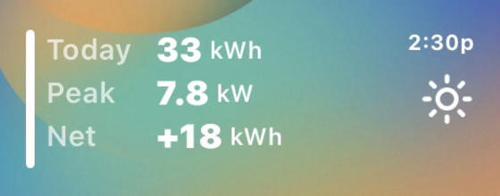

1. Wake your iPhone and press and hold the Lock Screen.
2. Tap **Customize**. Your Lock Screen opens for editing.
3. Tap the widget box.
4. The box holds two wide widgets. If it is full, tap the **−** at the top left of one to remove it.
5. Scroll the list of apps at the bottom and tap **Scriptable**. A Scriptable widget drops into the empty spot. If you are offered a choice of shapes, choose the wide one.
6. Tap the new widget. Next to **Script**, choose **OverEngineered Solar**. Leave the other settings as they are.
7. Tap **Done**.

The Lock Screen widget counts from midnight. The Home Screen widget shows the last 24 hours, so the two will differ, most of all in the morning. The Lock Screen Net is how much today has added to, or taken from, your bank.

Peak on the Lock Screen is the highest power reached today. The kW number on the Home Screen widget is different: it is the best peak your array reached in the last five clear days (a bright day with thin high cloud counts too, if its peak is a new best), and it is what the Max Power and Dirty labels are judged against.

A tap on it opens the Enphase app, the same as the Home Screen widget. It asks iOS for a refresh about every 15 minutes during the day, so it keeps up with the Home Screen widget. Those refreshes only redraw the saved numbers; they make no Enphase requests.

### Updating to a newer version

Paste the new code over the old script in Scriptable. Your settings and login are kept in separate files, so there is nothing to redo.

## Messages you might see

| On the widget | Meaning |
|---|---|
| Run the setup script first | No settings were found. Run setup. |
| Reauth needed | Enphase no longer accepts the saved login. Run setup and tap "Log in again". |
| No data from Enphase yet | Enphase did not return data and nothing is saved yet. The line under it says what to check. |
| Something went wrong | An unexpected error. Run the widget script inside Scriptable to see the details. |

## Why it isn't fully real time

The widget updates about once an hour while the sun is up (occasionally an hour and a quarter), every one to two hours in the evening, and not at all between 10 PM and 5 AM. The time in the top right corner is the time of the newest data, so it shows how fresh the numbers are. The weather icon is refreshed about every half hour in daylight, which costs no Enphase requests. That pace is on purpose, and there are two reasons.

- **Enphase's free plan allows 1,000 requests a month.** That is roughly 33 a day, and one refresh can take more than one request. Updating every few minutes would use up the month in a few days.
- **iOS decides when a widget runs.** A script can ask to be woken, but iOS picks the actual moment and often runs it late. No Home Screen widget can be truly live.

Enphase also publishes each 15-minute reading before it is complete, and takes about ten minutes to finish it. The widget waits for the finished reading before showing it as "current power", so that figure is typically 10 to 25 minutes behind the Enphase app.

### How it stays under 1,000 requests

- The widget counts every request it makes and keeps the running total for the month.
- It plans each month to about 950 requests and refuses to go past 990, leaving a margin under the limit.
- Nothing is requested between 10 PM and 5 AM.
- If Enphase's data stops updating for a while, the widget checks about once an hour instead of on every run, so it never burns through the day waiting.
- Production is requested about hourly while the sun is up, plus one request about 30 minutes after sunset to pick up the evening's last readings.
- Consumption is requested every two hours, and hourly near the start and end of the day when the month has requests to spare.
- Daily totals and the fault check are requested once a day.
- Opening the script by hand only uses spare requests. If there are none, it shows saved data.

In simulated months, including heavy-use ones, the busiest came to about 950 requests and no day went without data.

## How it works

For what the scripts do, which requests they make, how each number is worked out and how to change things, see [DEVELOPERS.md](DEVELOPERS.md).

### See it before you set it up

`dev-sandbox-overengineered-solar.js` shows the widget with made-up numbers: small and large arrays, sunny and cloudy days, a dirty array, the Lock Screen widget and more. Paste it into Scriptable the same way as the other scripts and run it. It needs no Enphase account and never goes online. It is also the place to try a change of your own.

## Privacy

Everything stays on your phone. Setup saves two files in Scriptable's local storage: `overengineered-solar-config.json` (your settings and keys) and `overengineered-solar-token.json` (your Enphase login tokens). The scripts talk only to Enphase, to Open-Meteo for weather, and, if you entered a ZIP code, to Zippopotam.us to turn it into coordinates.

## Debugging

If something looks wrong, open Scriptable and tap the widget script to run it. It shows a debug report and copies it to the clipboard, so you can paste it straight into a new issue on GitHub. The report is safe to share: keys, tokens and your system ID appear only as their last four characters. The setup script copies a similar report when it finishes.

## Support

This isn't my full-time job, so I have little time to make updates, and the widget is shared as it is. I would still love to hear if it helped you as much as it helped me, or if you think this is what Enphase should build. Open an issue on GitHub to tell me. It doesn't have to be a problem.

**Why isn't this in the App Store?** Because then I'd have to maintain it, and I'm much happier over-engineering things than supporting them. So it stays free and runs on your own free Enphase developer account. If it made your day a little easier, [buy me a coffee](https://buymeacoffee.com/overengineeredtech) and I'll turn it into something else to over-engineer! ;)

This widget is free and always will be for personal use. If it's useful to you and you'd like to say thanks, you can buy me a coffee: [buymeacoffee.com/overengineeredtech](https://buymeacoffee.com/overengineeredtech)

## Appendix: Example days

Each picture is a different day, drawn with made-up numbers, to show what the colours mean. Green means on track, orange means behind, and red means something needs attention.

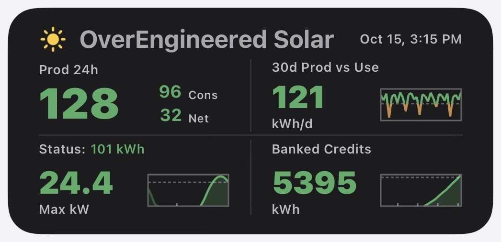

**A good day.** A sunny afternoon. Production is above your 30-day average and ahead of yesterday at this time, so every number is green. "Status: 101 kWh" is today's production so far.

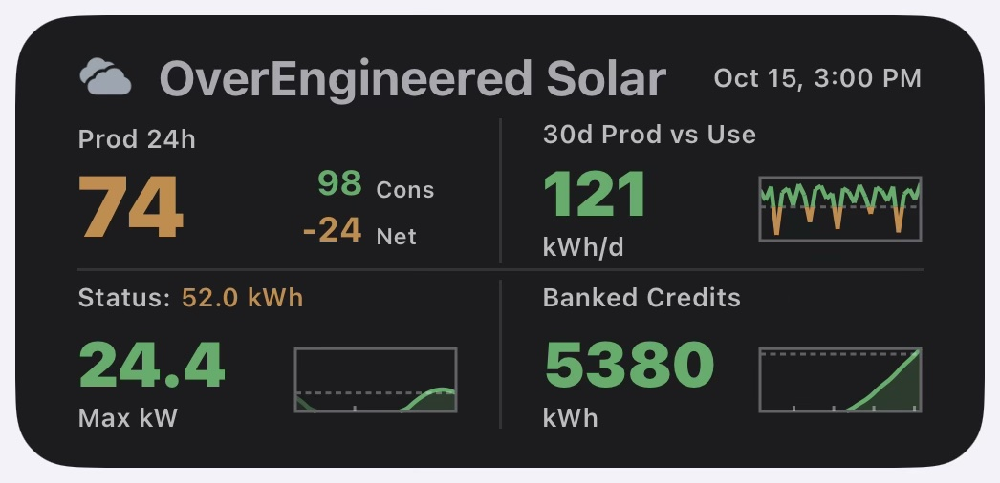

**A cloudy day.** The last 24 hours (74) is under your 30-day average, so that number and Net are orange. Today's 52.0 kWh is behind yesterday at this time, so it is orange too. Nothing is wrong with the array; it is just a dull day.

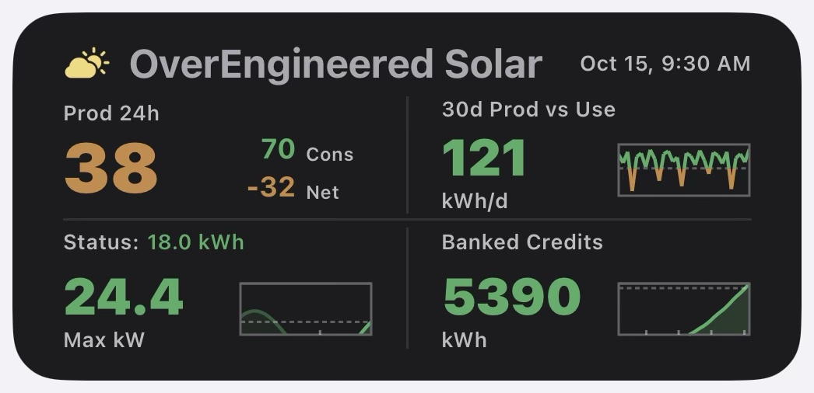

**Morning.** Early in the day the last 24 hours (38) is under your 30-day average, so it is orange. Today so far (18.0 kWh) is ahead of yesterday at this time, so it is green.

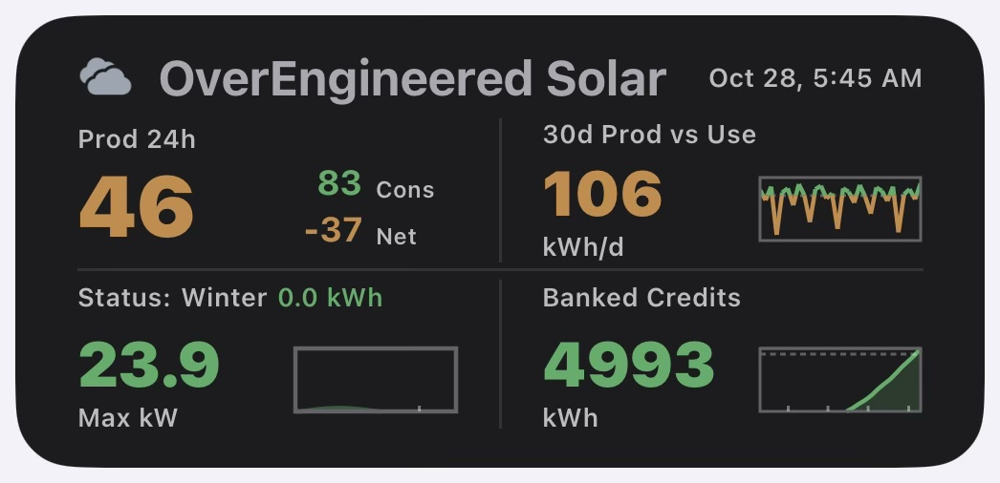

**Winter dawn.** Before sunrise in winter. "Winter" means the sun is too low to judge the panels, so Max kW holds its last real value (23.9) until spring. Today's figure is 0.0 kWh because the sun has not come up. The last 24 hours and Net are orange because winter days make less than your 30-day average.

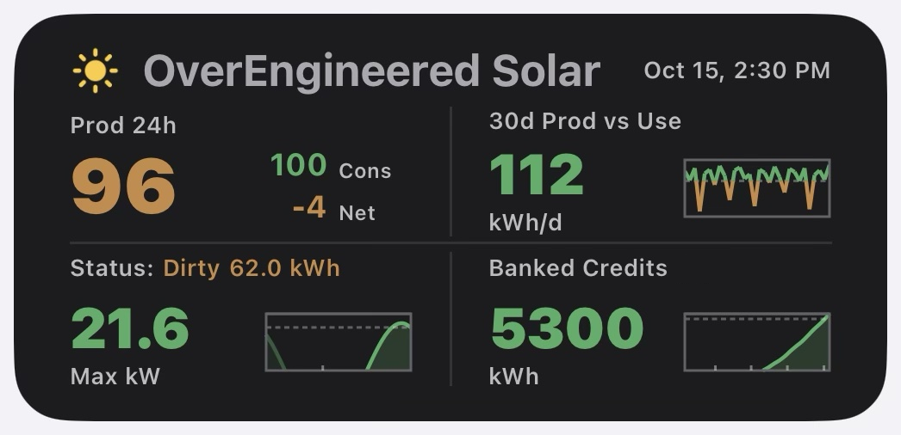

**Dirty.** The array's peak has dropped a little (21.6 kW, against about 24 on a clear day). The heading says Dirty in orange and today's figure turns the same orange. The panels may need washing.

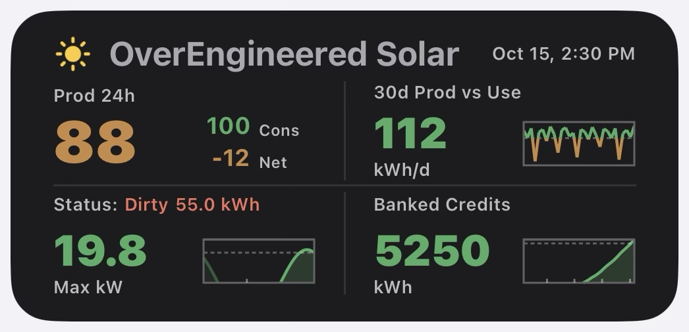

**Very dirty.** The peak has dropped a lot (19.8 kW). The word and the figure turn red. The panels very likely need washing.

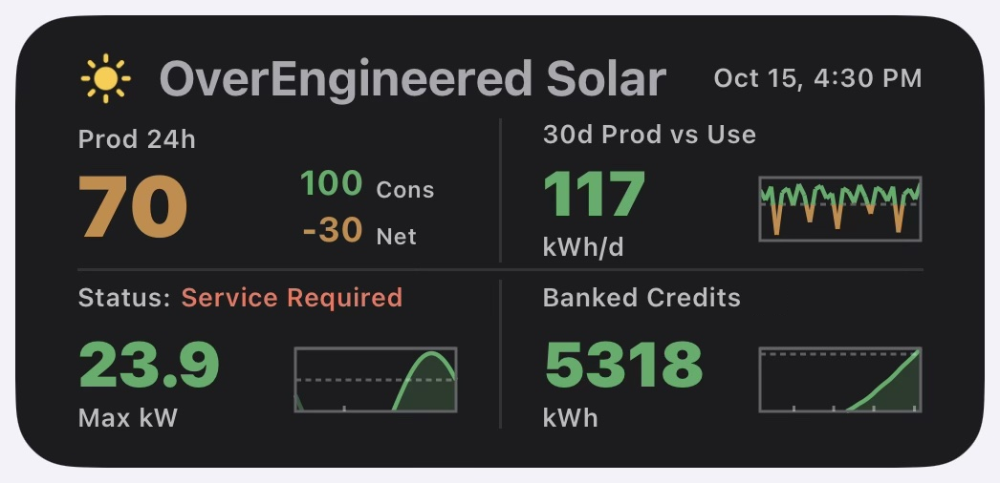

**Service Required.** Enphase is reporting a hardware fault, such as a failed microinverter or meter. The heading turns red and shows no figure. Open the Enphase app to see which part.
